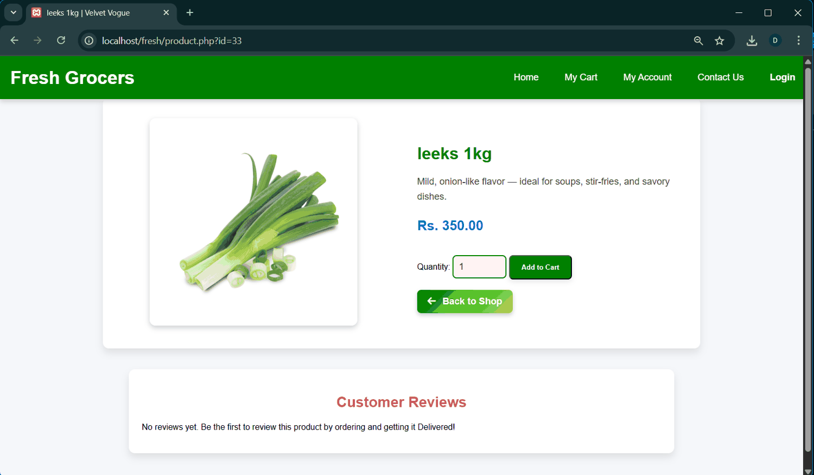

# Fresh Grocers

A PHP grocery-ordering prototype with a product catalogue, cart, checkout pages and an administration dashboard.

The storefront presents grocery categories and product details. The administration area covers product and order management. The [entity relationship diagram](docs/diagrams/entity-relationship-diagram.png) documents the database design.

**Technologies**  
PHP · mysqli · MySQL · JavaScript

[View the administration dashboard](docs/screenshots/admin-dashboard.png)

## Run locally

Serve `web-app/` with PHP and the mysqli extension. Set `FRESH_DB_HOST`, `FRESH_DB_USER`, `FRESH_DB_PASSWORD` and `FRESH_DB_NAME` in the server environment. Database-backed workflows require the matching MySQL schema from a separate backup. Once configured, open `index.php` on the local server.

## Author

Maleesha Dewmina Perera
