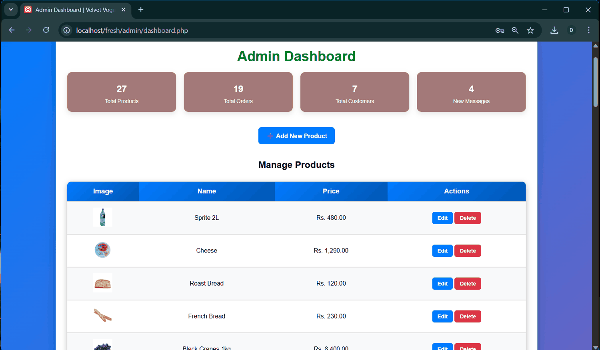
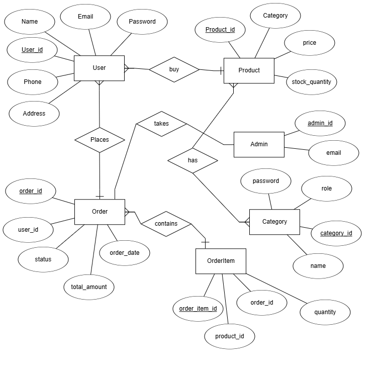

# Fresh Grocers — Web-Based Grocery Ordering System

> **Academic system analysis, design and web implementation** · Pearson BTEC HND in Computing · Unit 35: System Analysis & Design · 2025

Fresh Grocers homepage (upload pending)

Fresh Grocers is a coursework project for a Sri Lankan grocery delivery business scenario. It combines systems analysis and software design artifacts with an archived PHP-based grocery shopping prototype. The intended user journeys include browsing groceries, managing a shopping cart, submitting orders, and managing products through an administrative interface.

**Maintainer / academic author:** [Maleesha Dewmina Perera](https://github.com/MaleeshaDewmina)

## Project highlights

| Area | Scope and evidence |
|---|---|
| Customer experience | Home page, product listing and product details shown in the original report |
| Shopping flow | Cart and checkout PHP pages are present in the supplied source |
| Admin experience | Dashboard and product-management files are present; an original dashboard screenshot is documented |
| Data model | Conceptual ER diagram from the coursework report |
| Process modeling | Use-case, Level 1 data-flow diagram, and order-placement flowchart |
| Analysis | Agile vs. traditional methods, feasibility analysis and requirements in the original coursework |

**Project status:** Historical academic prototype. The code has not been deployed or end-to-end tested during this portfolio preparation. The provided ZIP does **not** contain the MySQL database export / migrations, and some legacy module references and business logic still require refactoring. It is **not** ready for public production hosting or real payments.

## Tech stack

- PHP (server-side rendering and handlers), HTML5, CSS3, JavaScript
- MySQL / `mysqli`
- Local development with PHP + MySQL (e.g., XAMPP)
- VS Code and design diagrams documented in the assignment report

## Screenshots from the submitted assignment

| Home page | Product listing |
|---|---|
| Homepage screenshot (upload pending) | Product listing screenshot (upload pending) |
| Product details | Admin dashboard |
|  |  |

The published screenshots are **original screenshots embedded in the submitted June 2025 assignment**, not fresh runtime test results. Some displayed sample prices and product records are historical demonstration data.

## System design diagrams

### Entity-Relationship Diagram



### Use-case model

Use-case diagram from coursework (upload pending)

### Data flow

Level 1 DFD (upload pending)

### Order-placement process

Original order-flow chart (upload pending)

For image provenance and the distinction between design requirements and implemented functionality, see [report figure notes](docs/notes/report-figures.md).

## Project layout

```text
web-app/                 PHP prototype and app assets
  admin/                 Admin-side PHP handlers and screens
  css/, js/, images/     Styles, scripts, and product image assets
  includes/              Shared page fragments and MySQL connection
  index.php              PHP application landing page
docs/
  screenshots/           Screenshots from original 2025 assignment
  diagrams/              ERD, use case, DFD, and order flow
  notes/                 Figure provenance and code audit
README.md                Documentation
.gitignore               Local files excluded from Git
```

## Running it locally — development reference

1. Install PHP, MySQL, and a local web server (for example, XAMPP).
2. Copy the `web-app/` directory under your development server document root (for example, `htdocs/fresh-grocers`).
3. Enable the PHP mysqli extension. Configure the database using `FRESH_DB_HOST`, `FRESH_DB_USER`, `FRESH_DB_PASSWORD` and `FRESH_DB_NAME` (defaults to `fresh_grocers`) via your local environment or server config.
4. **Restore the project's original MySQL schema** from your own backup if available. No matching database dump or SQL migration was present in the uploaded ZIP. The database tables and expected columns must be checked against the PHP code before the site can be used.
5. Open `http://localhost/fresh-grocers/index.php` after configuring the server and database.

This is a **reference setup**, not a verified installation procedure. Some pages may fail until the correct database schema is restored and legacy source inconsistencies are resolved.

**Never upload a real `.env` file, database dump containing personal records, or live credentials.** The unprotected sample admin-account seeder, password-debugging endpoint, and database test endpoint were excluded from this portfolio archive.

## Known limitations and engineering opportunities

- The original source carried some leftover clothing-store (`Velvet Vogue`) page labels. Visible title strings were normalised to *Fresh Grocers* for consistency; business logic and some clothing-related filtering remain in the archived source.
- The source references multiple relational tables, but the supplied ZIP did not include a database schema or its data. The ER diagram illustrates the **design** and is not a verified mapping to every table used by the code.
- The checkout offers payment choices but no verified payment-provider integration. **Do not process live card payments** with this code.
- Some scripts depend on sessions, server-side validation and error handling that require security review. The checkout currently reads a posted total, so totals should be recomputed on the server before any real use.
- Third-party imagery, icon fonts and design assets may have separate licences. Review permissions and attribution before commercial redistribution.

SMS delivery notifications and proximity-based driver matching appear in the design. Their implementation has not been verified.

## Academic attribution

**Project:** Web-Based System for “Fresh Grocers”

**Author:** Maleesha Dewmina Perera

**Module:** Unit 35 — System Analysis & Design (Pearson BTEC HND in Computing), 2025.

**Evidence source:** Author's own submitted coursework report and archived source ZIP. Published screenshots and diagrams are reproduced from that report; only project-owned report visuals were selected for documentation. The complete assignment report, with student and assessor information, is intentionally **not** included in this public repository.

---

*Portfolio reconstruction note:* This repository preserves a historical learning project and demonstrates the associated systems-analysis methods. Features are not claimed as production-ready or independently verified.
